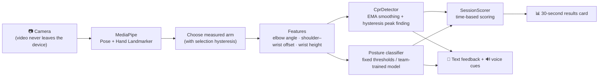

<div align="center">


# LifeAssist CPR

**An AI chest-compression coach for students and the community — the AI runs entirely in the browser, and no video is ever uploaded.**

*Real-time compression-rate and arm-posture feedback from a single camera. No video leaves your device.*

[](https://waicy.org)
[](#submission-materials)
[](https://react.dev/)
[](https://www.typescriptlang.org/)
[](https://vite.dev/)
[](https://ai.google.dev/edge/mediapipe/solutions/guide)
[](https://threejs.org/)
[](#8-pwa--offline)
[](#7-privacy)
[](#10-honest-status--limitations)

[🌐 Live Demo](https://lifeassist-cpr-pi.vercel.app/) • [📎 Submission](#submission-materials) • [✨ Features](#2-features) • [🧠 Algorithms](#3-how-it-works) • [🏗️ Structure](#4-project-structure) • [🚀 Quick Start](#5-quick-start) • [🔒 Privacy](#7-privacy) • [⚠️ Limitations](#10-honest-status--limitations)

</div>

---

> [!WARNING]
> **LifeAssist CPR is a tool for _practising_ compression rate and arm posture from a 2D side view.**
> It **cannot measure compression depth** (5–6 cm), **does not diagnose**, and **does not replace** medical professionals or a certified CPR course.
> In a real emergency: **call 115 immediately**.

---

## Submission Materials

**WAICY 2026 — AI Showcase** · **Pending Results: WAICY 2026**

| Item | Link |
| :--- | :--- |
| 📝 **Description & AI Usage** | [PASTE_DESCRIPTION_AND_AI_USAGE_LINK_HERE](PASTE_DESCRIPTION_AND_AI_USAGE_LINK_HERE) |
| 🎬 **Demo Video** | [PASTE_DEMO_VIDEO_LINK_HERE](PASTE_DEMO_VIDEO_LINK_HERE) |
| 🎤 **Presentation Video** | [PASTE_PRESENTATION_VIDEO_LINK_HERE](PASTE_PRESENTATION_VIDEO_LINK_HERE) |
| 📎 **Additional Materials** | [Google Doc](https://docs.google.com/document/d/1dQWqOfxhNLPFBkVKDl3cy8mf6JskBu6ZNnNfqHjQKkU/edit?usp=sharing) |
| 🌐 **Live Demo** | [lifeassist-cpr-pi.vercel.app](https://lifeassist-cpr-pi.vercel.app/) |
| 🏁 **Status** | ⏳ **Pending Results: WAICY 2026** |

<!-- Before publishing, search this file for "PASTE_" and replace each placeholder with the real link. -->

---

## 1. Overview

Cardiac arrest can happen to anyone, anywhere, and early, correctly paced chest compressions are something non-medical people can do. But doing them well takes **practice with feedback**, while most learners only watch a video or practise briefly with an instructor.

**LifeAssist CPR** turns a phone or laptop into a coach: place the camera at the side, compress on a pillow or manikin, and the app tells you right away **whether you are compressing too fast or too slow** and **whether your arms and shoulders are in the right position**, in both text and voice.

| Principle | Meaning |
| :--- | :--- |
| 🔒 **Private by design** | The AI model runs inside the browser. No server receives video, and there are no accounts. Exactly what is (and is not) sent is listed in [Section 7](#7-privacy). |
| 🎯 **Honest about numbers** | Any figure that has not been measured on real data is not claimed. See [Section 10](#10-honest-status--limitations). |
| 🚨 **Emergency first** | A minimal Emergency mode: a call-115 button, a 110 BPM metronome and 4 guidance steps. |
| 🌏 **Bilingual** | The whole interface and the voice cues are available in Vietnamese and English. |

---

## 2. Features

### 2.1 Practice mode

| Feature | Details |
| :--- | :--- |
| **30-second session** | A 3-2-1 countdown, then 30 seconds of continuous compressions. An early-stop button is available. |
| **Real-time rate measurement** | Shows compressions per minute against the **100–120 per minute** target (AHA 2025). |
| **Arm-posture measurement** | Elbow angle (shoulder–elbow–wrist) and horizontal shoulder-to-wrist offset, normalised by torso length. |
| **Two separate feedback lines** | Rate and posture are shown independently and never overwrite each other. |
| **Voice cues** | 4 pre-recorded phrases (VI/EN): *push faster · slow down · straighten your arms · shoulders over your hands*. The app picks the cue "heard least recently", so a posture error is still announced while the rate is also wrong. |
| **110 BPM metronome** | A tick generated with WebAudio, accurately timed, no audio file needed. |
| **Results card** | Total compressions, average rate, % of time within 100–120/min, % of time with good posture, % of time actually compressing, and the **main issue**. |
| **Fair scoring** | Only the moments when you are compressing count (the 3 seconds of getting into position do not drag the score down). With less than 5 seconds of compressions, the app **prints no percentages** rather than a meaningless number. |
| **Guide video** | A video on posture and placing the camera at a 90° side view. |
| **3D overlay** | A wireframe of the arm and hand (Three.js) that follows real movement. |
| **AI coach avatar** | A 3D coach (Three.js) with six states (*ready · 110 BPM demo · good form · straighten elbows · push faster · slow down*). Each state has a text badge and a spoken line in Vietnamese or English, with a cool-down so cues do not repeat. |
| **Practice history** | The last 30 sessions are kept in the browser's `localStorage` (never uploaded) and can be deleted one by one or all at once. |
| **Session replay** | An optional recording of the practice session that is replayed inside the browser and only saved if the user presses download (`.webm`). It is never uploaded. |

### 2.2 Emergency mode (minimal)

- A **call-115 emergency button** (`tel:115`) in the most prominent position.
- A **110 BPM metronome** you can start with one tap, which works without a network connection.
- **4 hands-only CPR steps for adults**, citing AHA 2025 Part 7 and reminding users to check the original document.

### 2.3 Tools for the research team

- **Data recording** exports a 16-column CSV containing only *numeric joint coordinates* (no images, no audio).
- A second person presses the **Space bar** on every compression to provide an **independent ground truth** (`gt_tap`).
- Two Python scripts train the posture classifier and measure BPM error, **splitting train/test by person** (no data leakage).
- When a practice session ends with at least one compression, a **numeric summary** is also posted to an optional Google Sheets webhook so the team can log sessions (see [Section 7](#7-privacy)).

### 2.4 Robustness in real use

| Situation | Handling |
| :--- | :--- |
| GPU unavailable | Automatically falls back to CPU and tells the user. |
| *Full* model fails to load | Falls back to the *lite* model. |
| Camera denied, no camera, or page not served over https | Each error has its own message and is never lumped together. |
| Voice files missing | Uses a fallback synthetic voice and shows a yellow warning (never silent). |
| Low FPS (< 15) | Warns that the rate measurement may be less accurate. |
| Hand tracking lost | The rate counter resets its state, so jumping coordinates are not counted as compressions. |
| Coach-avatar voice files missing (`public/audio/coach/`) | Falls back to the browser's speech synthesis (`speechSynthesis`) in the chosen language. |
| Browser blocks `localStorage` | History and language choice are simply not saved; the session itself still works. |

---

## 3. How It Works



### 3.1 Compression-rate counter (`src/lib/cprDetector.ts`, written by the team)

The input signal is the **wrist height relative to the hip, normalised by torso length**, so it does not depend on the distance to the camera.

1. **Smoothing over time (ms), not over frames.** An EMA filter with `α = 1 − e^(−Δt/τ)` keeps the sensitivity independent of the device's FPS.
2. **Peak detection with hysteresis.** A compression is counted only when the signal rises by at least `minProminence` above the previous trough and then falls by at least `minProminence` from the peak.
3. **Rate over a 6-second sliding window:** `BPM = (peaks − 1) × 60 000 / elapsed time`.
4. **Noise rejection:** peaks closer than 270 ms are dropped, rates outside 40–200 are ignored, and compressions are considered stopped if no new peak appears for 2 seconds.

This class **does not depend on React or MediaPipe**, so it can be tested with plain Node.

### 3.2 Posture features (`src/lib/posture.ts`)

| Feature | Formula | Meaning |
| :--- | :--- | :--- |
| `elbowAngleDeg` | angle at the elbow of the shoulder–elbow–wrist triangle (aspect-ratio corrected) | 180° = straight arm |
| `offsetNorm` | `|shoulder x − wrist x| / torso length` | 0 = shoulder directly above the wrist |
| `wristYNorm` | `(wrist y − hip y) / torso length` | signal fed to the rate counter |

Three posture labels: `CORRECT_POSTURE` · `BENT_ELBOW` · `OFF_AXIS`. When both errors occur together, the app reports **bent elbow** first because it is easier to fix and has more impact.

### 3.3 Constants (`src/lib/config.ts`)

| Constant | Value | Source / status |
| :--- | :---: | :--- |
| Target rate | 100–120 per minute | AHA 2025, Part 7 |
| Emergency metronome | 110 BPM | Midpoint of the target range |
| `ELBOW_MIN_DEG` | 160° | ⚠️ **Estimated value**, not yet calibrated on data |
| `SHOULDER_OFFSET_MAX` | 0.28 | ⚠️ **Estimated value**, not yet calibrated on data |
| `minProminence` | 0.04 | ⚠️ **Estimated value**, not yet calibrated on data |
| Minimum visibility | 0.5 | Frames below this are discarded |
| Session | 30 s (+ 3 s countdown) | |
| Minimum data to print % | 5 s of compressions | Below this, no percentages are printed |

### 3.4 AI models

[MediaPipe Pose Landmarker](https://ai.google.dev/edge/mediapipe/solutions/vision/pose_landmarker) and Hand Landmarker are **off-the-shelf Google models; the team did not train them**. The parts the team wrote are: the rate counter, the posture features, the scorer, the feedback logic, and the data-collection / posture-classifier training toolkit.

---

## 4. Project Structure

```text
.
├── src/
│   ├── App.tsx                      # App shell, VI / EN language switch
│   ├── i18n.ts                      # All bilingual UI strings
│   ├── components/
│   │   ├── PoseTracker.tsx          # Camera, detection loop, HUD, practice session
│   │   ├── CoachAvatar.tsx          # 3D coach avatar with spoken cues (Three.js)
│   │   ├── HistoryPanel.tsx         # Practice history (last 30 sessions, local only)
│   │   ├── EmergencyPanel.tsx       # Emergency mode: call 115, metronome, 4 steps
│   │   ├── SummaryCard.tsx          # End-of-session results card
│   │   └── RecorderPanel.tsx        # CSV data recording for the research team
│   ├── lib/
│   │   ├── cprDetector.ts           # ⭐ Compression counter (time-based EMA + hysteresis peaks)
│   │   ├── posture.ts               # Elbow angle, shoulder–wrist offset, arm selection, threshold baseline
│   │   ├── postureModel.ts          # Loads the team-trained classifier if present
│   │   ├── sessionScorer.ts         # Time-based session scoring
│   │   ├── audio.ts                 # Pre-recorded voice + WebAudio metronome
│   │   ├── csvRecorder.ts           # Joint-coordinate CSV export (no images)
│   │   ├── coachAudio.ts            # Coach cues (text + audio), cool-down, speech-synthesis fallback
│   │   ├── historyStorage.ts        # Practice history in localStorage (max 30 entries)
│   │   ├── sheetsSync.ts            # Optional numeric session summary → Google Sheets webhook
│   │   ├── config.ts                # Every "magic number" of the system
│   │   └── assets.ts                # Asset paths that also work when deployed in a sub-folder
│   ├── tracking/                    # Two-arm tracking + 3D wireframe overlay (Three.js)
│   └── model/                       # posture_lr.json (only exists after training on real data)
├── public/
│   ├── mediapipe/                   # .task models + wasm, served locally (no CDN calls)
│   ├── audio/{vi,en}/               # faster · slower · straighten · shoulders (.mp3)
│   │   └── (coach/{vi,en}/ is read by the coach avatar; not in the repo yet → speech-synthesis fallback)
│   ├── icons/                       # PWA icons 192 / 512 / maskable
│   └── cpr-guide.mp4                # Posture and camera-placement guide video
├── ml/                              # Python: training + evaluation (leave-one-person-out)
│   ├── train_classifier.py
│   ├── eval_bpm.py
│   ├── make_synthetic_demo.py       # SYNTHETIC data, only for trying the pipeline
│   └── data/                        # Participant data (git-ignored)
├── tools/
│   ├── check-assets.mjs             # Checks required files
│   ├── test-detector.ts             # Tests the rate counter with simulated signals
│   └── test-lib.ts                  # 26 unit checks
└── docs/                            # Data collection, audio recording, offline test, medical sources
```

---

## 5. Quick Start

### 5.1 Requirements

- **Node.js** 22 or newer (needed for `--experimental-strip-types` when running the tests)
- A modern browser with a camera (Chrome, Edge, Safari, Firefox)

### 5.2 Install and run

```bash
npm ci
npm run check:assets    # check required files (models, icons, voice cues)
npm run test:detector   # test the rate counter with simulated signals
npm run dev             # http://localhost:5173
```

```bash
npm run build && npm run preview   # production build
```

> [!IMPORTANT]
> **The camera only works on `https://` or `localhost`.**
> To try it on a phone, open the deployed https version. Opening `http://192.168.x.x` will **not** enable the camera.

### 5.3 npm scripts

| Command | Purpose |
| :--- | :--- |
| `npm run dev` | Start the development server (Vite) |
| `npm run build` | Type-check (`tsc -b`) then build for production |
| `npm run preview` | Preview the production build |
| `npm run lint` | Lint the code with oxlint |
| `npm run check:assets` | Check models, icons and the 8 voice files |
| `npm run test:detector` | Test the rate counter (15/30/60 FPS, 90–140 BPM, noise, dropped frames, lost hand tracking) |

Run the unit tests separately with: `node --experimental-strip-types tools/test-lib.ts`.

### 5.4 Deployment

The project is a static site that can be deployed to Vercel, Netlify or GitHub Pages. Every asset path uses `import.meta.env.BASE_URL`, so it works correctly even in a sub-folder (for example `/repo-name/`). Make sure the deployment is served over **https**.

---

## 6. Data and Training Workflow

Goals: (1) calibrate the posture classifier on real data, and (2) measure the rate-counting error against the true compression rate.

```bash
pip install -r ml/requirements.txt

python ml/eval_bpm.py --data ml/data           # BPM error vs gt_tap       → ml/results/bpm_eval.md
python ml/train_classifier.py --data ml/data   # LOPO + threshold baseline → ml/results/posture_eval.md
                                               #                           → src/model/posture_lr.json
```

| Principle | How it is done |
| :--- | :--- |
| **No data leakage** | Train/test split **by person** (leave-one-person-out), never by frame. |
| **Always a baseline** | The logistic-regression model is always compared with the fixed-threshold classifier used in the app, even when the two are equal. |
| **Complete reporting** | Mean ± spread across people, tables by camera angle / lighting / device, confusion matrix, hardest participant. |
| **Refuses premature export** | Both scripts refuse to export a model into the app if the data is `SYNTHETIC_` or has fewer than **6 people**. |
| **Independent ground truth** | The true rate is the Space-bar presses by a second person, **never** the metronome beep. |

When `src/model/posture_lr.json` exists, the UI automatically changes the line *"Classifier: fixed thresholds"* to *"Classifier: team-trained model"*.

For camera placement, posture labels, the parental consent form and the list of things you must not do, see [`docs/DATA_COLLECTION.md`](./docs/DATA_COLLECTION.md).

---

## 7. Privacy

| Topic | How it is handled |
| :--- | :--- |
| **Video** | Processed entirely on the device. Never sent anywhere. The optional session replay stays in browser memory and is only saved to the user's device if they press download. |
| **Practice history** | The last 30 session summaries are stored in the browser's `localStorage` on the user's own device. |
| **Session summary sent to the team** | When a practice session ends with at least one compression, a **numeric summary** (compression count, duration, average rate, % in range, % good posture, main issue) plus the research fields set in the recorder panel (subject code, posture label, camera angle, lighting, device / notes) is posted to a **Google Sheets (Apps Script) webhook** used by the team. **No video, images, audio or joint coordinates are included.** The URL can be replaced or disabled with the `VITE_SHEETS_WEBHOOK_URL` environment variable. |
| **Collected research data** | Only when the user explicitly starts recording: **numeric joint coordinates**, downloaded as a CSV. No images, no audio, no faces. |
| **Identity** | Data is tagged with an **anonymous code** (S01, S02, …). The code ↔ name table is not in the repo. |
| **Participants who are minors** | Parental consent is required. `ml/data/*` is in `.gitignore` and **must not be pushed to a public GitHub repository**. |
| **Third-party requests** | The page loads its fonts from Google Fonts. The AI models and WebAssembly files are served from the app itself (no CDN). |
| **Accounts** | None. |

---

## 8. PWA & Offline

The app has a manifest, icons (192 / 512 / maskable) and a service worker (`vite-plugin-pwa`) that caches the models, wasm and voice files (about 35 MB) so it can be installed to the home screen.

> [!NOTE]
> The cache configuration is in place, but **fully offline operation has not yet been verified on a real phone**. The airplane-mode test procedure is in [`docs/OFFLINE_TEST.md`](./docs/OFFLINE_TEST.md). Only say "works offline" after passing every step there.

---

## 9. Quick User Guide

1. Place the camera **at hip height, in a 90° side view**, about 1.5 m away, so that the **shoulder, elbow, wrist and hip** on the same side are clearly visible.
2. Wear fitted clothing (loose clothing increases error) and compress on a **pillow or manikin**, never on a real person.
3. Choose **Practice** → *Start 30-second session* → get into position during the countdown.
4. Follow the prompts: a rate of **100–120 per minute**, **straight elbows**, and **shoulders directly above your wrists**.
5. Read the results card and the main issue, then practise again.

---

## 10. Honest Status & Limitations

This is a **prototype, v0.2.0**. The team states what is and is not verified so that readers are not misled.

### ✅ Verified

| Item | Result |
| :--- | :--- |
| Rate counter on **simulated signals** (15 / 30 / 60 FPS, 90–140 BPM, noise, jittery FPS) | Counts the expected number of compressions; maximum BPM error **0.2** on simulated signals |
| Standing still + noise | 0 false compressions |
| Pause mid-session, hand tracking lost then coordinates jump | No false counts |
| Unit tests (`tools/test-lib.ts`) | **26/26** pass (angles, thresholds, arm selection, scoring, CSV, FPS invariance) |

> These are results on **simulated signals**, not accuracy measured on real people.

### ⚠️ Not yet verified

- Performance and FPS on real phones, especially low-end devices.
- Offline operation and the PWA on a real phone.
- The thresholds 160°, 0.28 and `minProminence = 0.04` are **estimates**, not yet calibrated on real data.
- Very shallow compressions (wrist amplitude < 0.04 of torso length), such as light compressions on a pillow, may not be counted.
- Simulation suggests that dropping 30% of frames at 15 FPS loses about 7% of compressions.
- There is no team-trained classifier yet (it needs data from at least 6 people).
- The coach avatar's voice lines (`public/audio/coach/`) have not been recorded; until then the browser's speech synthesis is used, and its voice quality depends on the device.

### ❌ Inherent limits of the approach

- **Compression depth cannot be measured** because only a 2D side-view camera is used.
- Results depend on camera angle, lighting and clothing.
- Only **one person** is tracked and **one arm** is measured at a time.
- This is a practice tool, not a medical device.

### 🚫 What the app never says

It does not diagnose, never says "the victim is fine" or "no CPR needed", never promises to save a life, and never claims to measure compression depth.

---

## 11. Medical Sources

| Claim in the app | Source |
| :--- | :--- |
| Rate of 100–120 per minute; depth ≥ 5 cm and no more than 6 cm; hand placement on the lower half of the breastbone | [AHA 2025 Guidelines for CPR and ECC, Part 7: Adult Basic Life Support](https://cpr.heart.org/en/resuscitation-science/cpr-and-ecc-guidelines/adult-basic-and-advanced-life-support) |
| Medical emergency number **115** | Vietnam's emergency number |

The app uses **AHA 2025** as its standard. Some Vietnamese web pages still state a rate of "100 per minute" and a depth of "4–5 cm", which **differ** from AHA 2025. Details of each claim, how far it has been cross-checked, and what still needs confirmation are in [`docs/SOURCES_AND_CLAIMS.md`](./docs/SOURCES_AND_CLAIMS.md). The app only summarises; please check the original document.

---

## 12. Documentation

| Document | Contents |
| :--- | :--- |
| [`docs/DATA_COLLECTION.md`](./docs/DATA_COLLECTION.md) | Data-collection workflow, camera setup, parental consent template |
| [`docs/AUDIO_RECORDING.md`](./docs/AUDIO_RECORDING.md) | How to record the 8 voice files and the `ffmpeg` normalisation command |
| [`docs/OFFLINE_TEST.md`](./docs/OFFLINE_TEST.md) | The offline test on a real phone |
| [`docs/SOURCES_AND_CLAIMS.md`](./docs/SOURCES_AND_CLAIMS.md) | Medical sources and which claims are allowed / not allowed |
| [`docs/HANDOFF_24-11.md`](./docs/HANDOFF_24-11.md) | Handoff notes: what was done, what was verified, what remains |

---

## 13. Tech Stack

| Layer | Technology |
| :--- | :--- |
| **UI** | React 19, TypeScript, plain CSS |
| **Build** | Vite, `vite-plugin-pwa`, oxlint |
| **Perception** | MediaPipe Tasks Vision (Pose Landmarker + Hand Landmarker), run locally via WebAssembly (GPU, falling back to CPU) |
| **3D graphics** | Three.js (arm and hand wireframe, coach avatar) |
| **Audio** | Web Audio API (metronome, pre-recorded voice), `speechSynthesis` fallback |
| **Data analysis** | Python, NumPy, pandas, scikit-learn |
| **Optional logging** | Google Apps Script webhook → Google Sheets (numeric session summaries only) |

---

## 14. Team

**Grade 11 Mathematics, Pho Thong Nang Khieu (PTNK) High School for the Gifted — Group 1**
Project entered in **WAICY 2026 (AI Showcase)** · **Pending Results: WAICY 2026**

| Member | Role |
| :--- | :--- |
| Le Minh | _Role_ |
| Le Nghiem Gia Phu | _Role_ |
| Le Tran Quang Bao | _Role_ |
| Nguyen Ha Phuong | _Role_ |

---

## 15. Acknowledgements

- [MediaPipe](https://ai.google.dev/edge/mediapipe/solutions/guide) (Google): Pose Landmarker and Hand Landmarker models
- [American Heart Association](https://cpr.heart.org/): 2025 CPR & ECC guidelines
- [React](https://react.dev/), [Vite](https://vite.dev/), [Three.js](https://threejs.org/)
- Thanks to the friends who volunteered for data collection and to the parents who consented to their participation.

---

## 16. License

Released under the [MIT License](./LICENSE).

---

<div align="center">

**Learn to do CPR properly today, so you are ready to help someone when it matters.**

⭐ If this project is useful to you, please give us a star!

</div>
