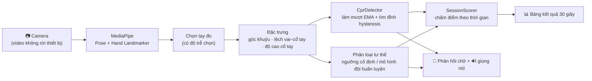

<div align="center">


# LifeAssist CPR

**Huấn luyện viên ép tim bằng AI cho học sinh và cộng đồng — chạy hoàn toàn trên trình duyệt, không gửi và không lưu video.**

*An on-device AI chest-compression coach. Real-time compression rate and arm-posture feedback from a single camera. No video leaves your device.*

[](https://waicy.org)
[](https://react.dev/)
[](https://www.typescriptlang.org/)
[](https://vite.dev/)
[](https://ai.google.dev/edge/mediapipe/solutions/guide)
[](https://threejs.org/)
[](#8-pwa--chạy-offline)
[](#7-quyền-riêng-tư)
[](#10-trạng-thái-trung-thực-và-giới-hạn)

[🚀 Chạy thử](#5-chạy-thử) • [✨ Tính năng](#2-tính-năng) • [🧠 Thuật toán](#3-cách-hoạt-động) • [🏗️ Cấu trúc](#4-cấu-trúc-dự-án) • [🔒 Riêng tư](#7-quyền-riêng-tư) • [⚠️ Giới hạn](#10-trạng-thái-trung-thực-và-giới-hạn)

</div>

---

> [!WARNING]
> **LifeAssist CPR là công cụ hỗ trợ _luyện tập_ nhịp ép và tư thế tay từ góc nhìn nghiêng 2D.**
> Ứng dụng **không đo được độ sâu ép** (5–6 cm), **không chẩn đoán** và **không thay thế** nhân viên y tế hay khoá học CPR có chứng chỉ.
> Trong tình huống thật: **gọi 115 ngay**.

---

## 1. Giới thiệu

Ngừng tim có thể xảy ra với bất kỳ ai, ở bất kỳ đâu, và ép tim sớm, đúng nhịp là việc người ngoài ngành y có thể làm được. Nhưng để làm đúng thì cần **luyện tập có phản hồi**, trong khi đa số người học chỉ xem video hoặc tập với người hướng dẫn trong thời gian ngắn.

**LifeAssist CPR** biến chiếc điện thoại hoặc laptop thành một huấn luyện viên: đặt camera nhìn nghiêng, ép tim lên gối hoặc manikin, và ứng dụng cho biết ngay **bạn ép nhanh hay chậm** và **tay, vai có đúng tư thế không** bằng cả chữ lẫn giọng nói.

| Nguyên tắc | Ý nghĩa |
| :--- | :--- |
| 🔒 **Riêng tư từ thiết kế** | Mô hình AI chạy ngay trong trình duyệt. Không có máy chủ nhận video, không có tài khoản. |
| 🎯 **Trung thực về số liệu** | Con số nào chưa đo thật thì không tuyên bố. Xem [mục 10](#10-trạng-thái-trung-thực-và-giới-hạn). |
| 🚨 **Khẩn cấp là ưu tiên** | Chế độ Khẩn cấp tối giản: nút gọi 115, metronome 110 BPM và 4 bước hướng dẫn. |
| 🌏 **Song ngữ** | Toàn bộ giao diện và giọng nhắc có tiếng Việt và tiếng Anh. |

---

## 2. Tính năng

### 2.1 Chế độ Luyện tập

| Tính năng | Chi tiết |
| :--- | :--- |
| **Bài tập 30 giây** | Đếm ngược 3-2-1, sau đó ép liên tục 30 giây. Có nút dừng sớm. |
| **Đo nhịp ép theo thời gian thực** | Hiển thị số lần/phút, so với mục tiêu **100–120 lần/phút** (AHA 2025). |
| **Đo tư thế tay** | Góc khuỷu tay (vai–khuỷu–cổ tay) và độ lệch ngang giữa vai và cổ tay, chuẩn hoá theo chiều dài thân. |
| **Phản hồi hai dòng riêng** | Nhịp và tư thế hiển thị tách biệt, không ghi đè lẫn nhau. |
| **Nhắc bằng giọng nói** | 4 câu thu sẵn (VI/EN): *ép nhanh hơn · ép chậm lại · duỗi thẳng tay · đưa vai lên trên hai tay*. Hệ thống chọn câu "lâu chưa nghe nhất" nên lỗi tư thế vẫn được nhắc khi nhịp đang sai. |
| **Metronome 110 BPM** | Tiếng tick sinh bằng WebAudio, đúng nhịp, không cần file âm thanh. |
| **Bảng kết quả** | Tổng số lần ép, nhịp trung bình, % thời gian đạt 100–120/phút, % thời gian tư thế tốt, % thời gian thực sự ép và **lỗi chính**. |
| **Chấm điểm công bằng** | Chỉ tính những lúc đang ép (3 giây vào tư thế đầu phiên không kéo điểm xuống). Ép chưa đủ 5 giây thì **không in phần trăm** thay vì in con số vô nghĩa. |
| **Video hướng dẫn** | Video tư thế và cách đặt camera nhìn nghiêng 90°. |
| **Lớp phủ 3D** | Khung dây cánh tay và bàn tay (Three.js) bám theo chuyển động thật. |

### 2.2 Chế độ Khẩn cấp (tối giản)

- **Nút gọi cấp cứu 115** (`tel:115`) ở vị trí nổi bật nhất.
- **Metronome 110 BPM** bật bằng một chạm, chạy được khi không có mạng.
- **4 bước CPR chỉ ép tim cho người lớn**, dẫn nguồn AHA 2025 Phần 7 kèm lời nhắc tự đối chiếu tài liệu gốc.

### 2.3 Công cụ cho nhóm nghiên cứu

- **Thu dữ liệu** xuất CSV 16 cột chỉ chứa *toạ độ khớp dạng số* (không có hình, không có âm thanh).
- Người thứ hai bấm **phím Cách** theo từng nhịp ép làm **chuẩn đối chiếu độc lập** (`gt_tap`).
- Hai script Python huấn luyện bộ phân loại tư thế và đo sai số BPM, **chia train/test theo người** (không rò rỉ dữ liệu).

### 2.4 Độ bền khi chạy thực tế

| Tình huống | Cách xử lý |
| :--- | :--- |
| GPU không khả dụng | Tự chuyển sang CPU và báo cho người dùng. |
| Mô hình *full* không nạp được | Hạ xuống mô hình *lite*. |
| Camera bị từ chối, không có camera, trang không phải https | Mỗi lỗi có thông báo riêng, không gộp chung. |
| Thiếu file giọng nói | Dùng giọng máy dự phòng và hiện cảnh báo vàng (không im lặng). |
| FPS thấp (< 15) | Cảnh báo rằng kết quả đo nhịp có thể kém chính xác. |
| Mất dấu tay | Bộ đếm nhịp reset trạng thái, toạ độ nhảy lung tung không bị đếm thành nhịp ép. |

---

## 3. Cách hoạt động



### 3.1 Bộ đếm nhịp ép (`src/lib/cprDetector.ts`, đội tự viết)

Tín hiệu vào là **độ cao cổ tay so với hông, chuẩn hoá theo chiều dài thân** để không phụ thuộc khoảng cách tới camera.

1. **Làm mượt theo thời gian (ms), không theo số khung hình.** Bộ lọc EMA với `α = 1 − e^(−Δt/τ)` nên độ nhạy không phụ thuộc FPS của máy.
2. **Tìm đỉnh có hysteresis.** Một lần ép chỉ được tính khi tín hiệu tăng ít nhất `minProminence` so với đáy trước rồi giảm ít nhất `minProminence` so với đỉnh.
3. **Tính nhịp trên cửa sổ trượt 6 giây:** `BPM = (số đỉnh − 1) × 60 000 / khoảng thời gian`.
4. **Loại nhiễu:** bỏ đỉnh sát nhau dưới 270 ms, bỏ nhịp ngoài khoảng 40–200, coi là ngừng ép nếu 2 giây không có đỉnh mới.

Lớp này **không phụ thuộc React hay MediaPipe**, nên kiểm thử được bằng Node thuần.

### 3.2 Đặc trưng tư thế (`src/lib/posture.ts`)

| Đặc trưng | Công thức | Ý nghĩa |
| :--- | :--- | :--- |
| `elbowAngleDeg` | góc tại khuỷu của tam giác vai–khuỷu–cổ tay (đã bù tỉ lệ khung hình) | 180° = tay thẳng |
| `offsetNorm` | `|x vai − x cổ tay| / chiều dài thân` | 0 = vai ngay trên cổ tay |
| `wristYNorm` | `(y cổ tay − y hông) / chiều dài thân` | tín hiệu đưa vào bộ đếm nhịp |

Ba nhãn tư thế: `CORRECT_POSTURE` · `BENT_ELBOW` · `OFF_AXIS`. Khi cả hai lỗi cùng xảy ra, ứng dụng báo **gập khuỷu** trước vì dễ sửa hơn và ảnh hưởng nhiều hơn.

### 3.3 Các hằng số (`src/lib/config.ts`)

| Hằng số | Giá trị | Nguồn / trạng thái |
| :--- | :---: | :--- |
| Nhịp mục tiêu | 100–120 lần/phút | AHA 2025, Phần 7 |
| Metronome Khẩn cấp | 110 BPM | Nằm giữa khoảng mục tiêu |
| `ELBOW_MIN_DEG` | 160° | ⚠️ **Con số ước đoán**, chưa hiệu chỉnh từ dữ liệu |
| `SHOULDER_OFFSET_MAX` | 0,28 | ⚠️ **Con số ước đoán**, chưa hiệu chỉnh từ dữ liệu |
| `minProminence` | 0,04 | ⚠️ **Con số ước đoán**, chưa hiệu chỉnh từ dữ liệu |
| Độ hiển thị tối thiểu | 0,5 | Khung hình thấp hơn bị loại |
| Phiên tập | 30 s (+ đếm ngược 3 s) | |
| Dữ liệu tối thiểu để in % | 5 s ép | Dưới mức này không in phần trăm |

### 3.4 Mô hình AI

[MediaPipe Pose Landmarker](https://ai.google.dev/edge/mediapipe/solutions/vision/pose_landmarker) và Hand Landmarker là **mô hình có sẵn của Google, đội không huấn luyện chúng**. Phần do đội tự viết gồm: bộ đếm nhịp, các đặc trưng tư thế, bộ chấm điểm, logic phản hồi, và bộ công cụ thu dữ liệu / huấn luyện phân loại tư thế.

---

## 4. Cấu trúc dự án

```text
.
├── src/
│   ├── App.tsx                      # Vỏ ứng dụng, chuyển ngôn ngữ VI / EN
│   ├── i18n.ts                      # Toàn bộ chuỗi giao diện song ngữ
│   ├── components/
│   │   ├── PoseTracker.tsx          # Camera, vòng lặp nhận diện, HUD, phiên tập
│   │   ├── EmergencyPanel.tsx       # Chế độ Khẩn cấp: gọi 115, metronome, 4 bước
│   │   ├── SummaryCard.tsx          # Bảng kết quả cuối phiên
│   │   └── RecorderPanel.tsx        # Thu dữ liệu CSV cho nhóm nghiên cứu
│   ├── lib/
│   │   ├── cprDetector.ts           # ⭐ Đếm nhịp ép (EMA theo ms + đỉnh hysteresis)
│   │   ├── posture.ts               # Góc khuỷu, độ lệch vai–cổ tay, chọn tay, baseline ngưỡng
│   │   ├── postureModel.ts          # Nạp bộ phân loại đội huấn luyện nếu có
│   │   ├── sessionScorer.ts         # Chấm điểm phiên theo thời gian
│   │   ├── audio.ts                 # Giọng nói thu sẵn + metronome WebAudio
│   │   ├── csvRecorder.ts           # Xuất CSV toạ độ khớp (không có hình ảnh)
│   │   ├── config.ts                # Mọi hằng số "con số" của hệ thống
│   │   └── assets.ts                # Đường dẫn tài nguyên đúng cả khi triển khai ở thư mục con
│   ├── tracking/                    # Theo dõi hai tay + lớp phủ khung dây 3D (Three.js)
│   └── model/                       # posture_lr.json (chỉ có sau khi huấn luyện từ dữ liệu thật)
├── public/
│   ├── mediapipe/                   # Mô hình .task + wasm, chạy cục bộ (không gọi CDN)
│   ├── audio/{vi,en}/               # faster · slower · straighten · shoulders (.mp3)
│   ├── icons/                       # Icon PWA 192 / 512 / maskable
│   └── cpr-guide.mp4                # Video hướng dẫn tư thế và đặt camera
├── ml/                              # Python: huấn luyện + đánh giá (leave-one-person-out)
│   ├── train_classifier.py
│   ├── eval_bpm.py
│   ├── make_synthetic_demo.py       # Dữ liệu GIẢ, chỉ để thử đường ống
│   └── data/                        # Dữ liệu người tham gia (bị .gitignore)
├── tools/
│   ├── check-assets.mjs             # Kiểm tra file bắt buộc
│   ├── test-detector.ts             # Kiểm thử bộ đếm nhịp bằng tín hiệu giả lập
│   └── test-lib.ts                  # 26 kiểm tra đơn vị
└── docs/                            # Quy trình thu dữ liệu, thu âm, thử offline, nguồn y khoa
```

---

## 5. Chạy thử

### 5.1 Yêu cầu

- **Node.js** 22 trở lên (cần cho `--experimental-strip-types` khi chạy kiểm thử)
- Trình duyệt hiện đại có camera (Chrome, Edge, Safari, Firefox)

### 5.2 Cài đặt và chạy

```bash
npm ci
npm run check:assets    # kiểm tra file bắt buộc (mô hình, icon, giọng nói)
npm run test:detector   # kiểm thử thuật toán đếm nhịp bằng tín hiệu giả lập
npm run dev             # http://localhost:5173
```

```bash
npm run build && npm run preview   # bản production
```

> [!IMPORTANT]
> **Camera chỉ hoạt động trên `https://` hoặc `localhost`.**
> Để thử trên điện thoại, hãy mở bản đã triển khai qua https. Mở bằng `http://192.168.x.x` sẽ **không** bật được camera.

### 5.3 Các lệnh npm

| Lệnh | Tác dụng |
| :--- | :--- |
| `npm run dev` | Chạy máy chủ phát triển (Vite) |
| `npm run build` | Kiểm tra kiểu (`tsc -b`) rồi build production |
| `npm run preview` | Xem thử bản build |
| `npm run lint` | Kiểm tra mã bằng oxlint |
| `npm run check:assets` | Kiểm tra mô hình, icon, 8 file giọng nói |
| `npm run test:detector` | Kiểm thử bộ đếm nhịp (FPS 15/30/60, 90–140 BPM, nhiễu, rơi khung, mất dấu tay) |

Kiểm thử đơn vị chạy riêng: `node --experimental-strip-types tools/test-lib.ts`.

### 5.4 Triển khai

Dự án là một trang tĩnh, triển khai được lên Vercel, Netlify hoặc GitHub Pages. Mọi đường dẫn tài nguyên đều dùng `import.meta.env.BASE_URL` nên hoạt động đúng cả khi đặt ở thư mục con (ví dụ `/ten-repo/`). Hãy bảo đảm bản triển khai chạy trên **https**.

---

## 6. Quy trình dữ liệu và huấn luyện

Mục tiêu: (1) hiệu chỉnh bộ phân loại tư thế từ dữ liệu thật, (2) đo sai số đếm nhịp so với nhịp ép thật.

```bash
pip install -r ml/requirements.txt

python ml/eval_bpm.py --data ml/data           # sai số BPM so với gt_tap  → ml/results/bpm_eval.md
python ml/train_classifier.py --data ml/data   # LOPO + baseline ngưỡng    → ml/results/posture_eval.md
                                               #                           → src/model/posture_lr.json
```

| Nguyên tắc | Cách thực hiện |
| :--- | :--- |
| **Không rò rỉ dữ liệu** | Chia train/test **theo người** (leave-one-person-out), không theo khung hình. |
| **Luôn có baseline** | Mô hình hồi quy logistic luôn được so với ngưỡng cố định đang dùng trong app, kể cả khi hai bên ngang nhau. |
| **Báo cáo đầy đủ** | Trung bình ± độ lệch giữa các người, bảng theo góc máy / ánh sáng / thiết bị, ma trận nhầm lẫn, người khó nhất. |
| **Từ chối xuất mô hình sớm** | Hai script không xuất mô hình vào app nếu dữ liệu là `SYNTHETIC_` hoặc có ít hơn **6 người**. |
| **Chuẩn đối chiếu độc lập** | Nhịp thật là phím Cách do người thứ hai bấm, **không** dùng tiếng bíp metronome. |

Khi có `src/model/posture_lr.json`, giao diện tự đổi dòng *"Phân loại: ngưỡng cố định"* thành *"Phân loại: mô hình do đội huấn luyện"*.

Chi tiết cách bố trí camera, nhãn tư thế, phiếu đồng ý của phụ huynh và các điều không được làm: [`docs/DATA_COLLECTION.md`](./docs/DATA_COLLECTION.md).

---

## 7. Quyền riêng tư

| Vấn đề | Cách xử lý |
| :--- | :--- |
| **Video** | Xử lý hoàn toàn trên thiết bị. Không gửi đi đâu, không lưu. |
| **Dữ liệu thu thập** | Chỉ khi người dùng chủ động bấm ghi: **toạ độ khớp dạng số**, tải về dưới dạng CSV. Không có hình, không có âm thanh, không có khuôn mặt. |
| **Danh tính** | Dữ liệu gắn **mã ẩn danh** (S01, S02, …). Bảng đối chiếu mã ↔ tên không nằm trong repo. |
| **Người tham gia là trẻ vị thành niên** | Cần phiếu đồng ý của phụ huynh. Thư mục `ml/data/*` nằm trong `.gitignore`, **không được đưa lên GitHub công khai**. |
| **Tài khoản / máy chủ** | Không có. |

---

## 8. PWA và chạy offline

Ứng dụng có manifest, icon (192 / 512 / maskable) và service worker (`vite-plugin-pwa`) cache mô hình, wasm và file giọng nói (khoảng 35 MB) để cài lên màn hình chính.

> [!NOTE]
> Cấu hình cache đã sẵn sàng, nhưng **khả năng chạy hoàn toàn offline chưa được kiểm chứng trên điện thoại thật**. Quy trình thử bằng chế độ máy bay có trong [`docs/OFFLINE_TEST.md`](./docs/OFFLINE_TEST.md). Chỉ nên gọi là "chạy offline" sau khi đạt đủ các bước ở đó.

---

## 9. Hướng dẫn nhanh cho người dùng

1. Đặt camera **ngang hông, nhìn nghiêng 90°**, cách khoảng 1,5 m, sao cho thấy rõ **vai, khuỷu tay, cổ tay và hông** cùng một bên.
2. Mặc đồ ôm (áo rộng làm tăng sai số) và ép lên **gối hoặc manikin**, không ép lên người thật.
3. Chọn **Luyện tập** → *Bắt đầu bài tập 30 giây* → vào tư thế trong lúc đếm ngược.
4. Làm theo nhắc nhở: nhịp **100–120 lần/phút**, **khuỷu tay thẳng**, **vai ngay trên cổ tay**.
5. Xem bảng kết quả và lỗi chính, rồi tập lại.

---

## 10. Trạng thái trung thực và giới hạn

Đây là **prototype v0.2.0**. Nhóm ghi rõ điều đã kiểm chứng và chưa kiểm chứng để người đọc không bị dẫn dắt sai.

### ✅ Đã kiểm chứng

| Nội dung | Kết quả |
| :--- | :--- |
| Bộ đếm nhịp trên **tín hiệu giả lập** (15 / 30 / 60 FPS, 90–140 BPM, có nhiễu, FPS rung) | Đếm đủ số nhịp kỳ vọng; sai số BPM tối đa **0,2** trên tín hiệu giả lập |
| Đứng yên + nhiễu | 0 nhịp đếm nhầm |
| Nghỉ giữa chừng, mất dấu tay rồi nhảy toạ độ | Không bị đếm nhầm |
| Kiểm thử đơn vị (`tools/test-lib.ts`) | **26/26** qua (góc, ngưỡng, chọn tay, chấm điểm, CSV, bất biến theo FPS) |

> Đây là kết quả trên **tín hiệu mô phỏng**, không phải độ chính xác đo trên người thật.

### ⚠️ Chưa kiểm chứng

- Hiệu năng và FPS trên điện thoại thật, đặc biệt máy cấu hình thấp.
- Chạy offline và PWA trên điện thoại thật.
- Các ngưỡng 160°, 0,28 và `minProminence = 0,04` là **ước đoán**, chưa hiệu chỉnh từ dữ liệu thật.
- Ép rất nông (biên độ cổ tay < 0,04 chiều dài thân), chẳng hạn ép nhẹ trên gối, có thể không được đếm.
- Mô phỏng cho thấy rơi 30% khung hình ở 15 FPS làm mất khoảng 7% nhịp.
- Chưa có bộ phân loại do đội huấn luyện (cần dữ liệu từ ít nhất 6 người).

### ❌ Giới hạn vốn có của phương pháp

- **Không đo được độ sâu ép** vì chỉ dùng camera 2D nhìn nghiêng.
- Kết quả phụ thuộc góc đặt camera, ánh sáng và quần áo.
- Chỉ theo dõi **một người** và đo **một bên cánh tay** tại một thời điểm.
- Đây là công cụ luyện tập, không phải thiết bị y tế.

### 🚫 Những điều ứng dụng không nói

Không chẩn đoán, không nói "nạn nhân ổn" hay "không cần CPR", không hứa cứu sống, không nói đo được độ sâu ép.

---

## 11. Nguồn y khoa

| Tuyên bố trong app | Nguồn |
| :--- | :--- |
| Nhịp ép 100–120 lần/phút; sâu ≥ 5 cm và không quá 6 cm; đặt tay ở nửa dưới xương ức | [AHA 2025 Guidelines for CPR and ECC, Phần 7: Adult Basic Life Support](https://cpr.heart.org/en/resuscitation-science/cpr-and-ecc-guidelines/adult-basic-and-advanced-life-support) |
| Số cấp cứu y tế **115** | Số cấp cứu của Việt Nam |

Ứng dụng dùng **AHA 2025** làm chuẩn. Một số trang tiếng Việt vẫn ghi nhịp "100 lần/phút" và độ lún "4–5 cm", **khác** với bản AHA 2025. Chi tiết các tuyên bố, mức độ đã đối chiếu và những điều cần xác nhận thêm nằm ở [`docs/SOURCES_AND_CLAIMS.md`](./docs/SOURCES_AND_CLAIMS.md). Ứng dụng chỉ tóm tắt lại; vui lòng đối chiếu với tài liệu gốc.

---

## 12. Tài liệu

| Tài liệu | Nội dung |
| :--- | :--- |
| [`docs/DATA_COLLECTION.md`](./docs/DATA_COLLECTION.md) | Quy trình thu dữ liệu, bố trí camera, mẫu phiếu đồng ý phụ huynh |
| [`docs/AUDIO_RECORDING.md`](./docs/AUDIO_RECORDING.md) | Cách thu 8 file giọng nói và lệnh `ffmpeg` chuẩn hoá |
| [`docs/OFFLINE_TEST.md`](./docs/OFFLINE_TEST.md) | Bài thử chạy offline trên điện thoại thật |
| [`docs/SOURCES_AND_CLAIMS.md`](./docs/SOURCES_AND_CLAIMS.md) | Nguồn y khoa và các tuyên bố được phép / không được phép |
| [`docs/HANDOFF_24-11.md`](./docs/HANDOFF_24-11.md) | Bản bàn giao: đã làm gì, đã kiểm chứng gì, việc còn lại |

---

## 13. Công nghệ

| Lớp | Công nghệ |
| :--- | :--- |
| **Giao diện** | React 19, TypeScript, CSS thuần |
| **Build** | Vite, `vite-plugin-pwa`, oxlint |
| **Nhận diện** | MediaPipe Tasks Vision (Pose Landmarker + Hand Landmarker), chạy cục bộ bằng WebAssembly (GPU, tự hạ xuống CPU) |
| **Đồ hoạ 3D** | Three.js (khung dây cánh tay và bàn tay) |
| **Âm thanh** | Web Audio API (metronome, giọng thu sẵn), `speechSynthesis` dự phòng |
| **Phân tích dữ liệu** | Python, NumPy, pandas, scikit-learn |

---

## 14. Nhóm thực hiện

**Lớp 11 Toán, Trường Phổ thông Năng khiếu (PTNK) — Nhóm 1**
Dự án tham dự **WAICY 2026 (AI Showcase)**.

| Thành viên | Vai trò |
| :--- | :--- |
| _Họ tên_ | _Vai trò_ |
| _Họ tên_ | _Vai trò_ |
| _Họ tên_ | _Vai trò_ |

---

## 15. Ghi nhận

- [MediaPipe](https://ai.google.dev/edge/mediapipe/solutions/guide) (Google): mô hình Pose Landmarker và Hand Landmarker
- [American Heart Association](https://cpr.heart.org/): hướng dẫn CPR & ECC 2025
- [React](https://react.dev/), [Vite](https://vite.dev/), [Three.js](https://threejs.org/)
- Cảm ơn những bạn đã tình nguyện tham gia thu dữ liệu và phụ huynh đã đồng ý cho các bạn tham gia.

---

## 16. Giấy phép

Chưa có tệp `LICENSE` trong repository. Hãy thêm giấy phép (ví dụ MIT) trước khi công bố công khai.

---

<div align="center">

**Học ép tim đúng cách hôm nay, để sẵn sàng giúp người khác khi cần.**

⭐ Nếu dự án hữu ích, hãy tặng chúng mình một ngôi sao nhé!

</div>
